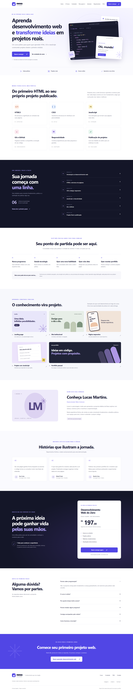

# Nexa Academy

Landing page de um curso fictício de **Desenvolvimento Web do Zero**, criada com HTML5, CSS3 e JavaScript puro. Uma experiência de edtech com identidade índigo, interfaces ilustradas em CSS e foco em responsividade e acessibilidade.

## Preview



## Funcionalidades

- Menu desktop e mobile, com estado acessível e fechamento por Escape.
- Navegação suave por âncoras e header adaptável durante a rolagem.
- Seis módulos expansíveis e FAQ interativo; um painel aberto por grupo.
- Modal demonstrativo com fechamento por Escape, botão ou clique fora, contenção de foco e retorno ao botão de origem.
- Botão de retorno ao topo e animações discretas com respeito à preferência de movimento reduzido.
- Cards de tecnologias, cinco mockups de projetos e apresentação de instrutor.
- Oferta, garantia, depoimentos e redes sociais explicitamente ilustrativos.
- Link para pular ao conteúdo, foco visível, HTML semântico e controles nativos.
- Título, descrição, Open Graph básico e favicon SVG próprio.

## Tecnologias

HTML5, CSS3 e JavaScript puro. Sem frameworks, pacotes de produção, fontes externas, backend ou banco de dados. As ilustrações são construídas com HTML/CSS: não há fotografias de pessoas ou imagens remotas. O visual do editor possui descrição acessível; mockups decorativos são ocultos de leitores de tela.

## Responsividade e validação

Testado em navegador Microsoft Edge com automação Playwright, nas larguras **320, 375, 425, 768, 1024 e 1440 px**.

Verificações realizadas:

- Ausência de rolagem horizontal em todos os tamanhos solicitados.
- Menu desktop e abertura, navegação e fechamento do menu mobile.
- Expansão/recolhimento de todos os módulos e perguntas frequentes.
- Operação do acordeão com Enter.
- Todos os botões de inscrição e redes ilustrativas abrindo o modal adequado.
- Modal: Tab, foco contido, retorno de foco, Escape, botão Entendi, botão fechar e clique no fundo.
- Links internos com destinos existentes, header durante scroll e retorno ao topo.
- Console sem erros e JavaScript validado por `node --check`.
- Revisão visual de capturas desktop e mobile.

A validação não representa auditoria completa de acessibilidade nem teste em todos os navegadores. Safari, Firefox e leitores de tela são boas próximas verificações.

## Estrutura

```text
/
├── index.html
├── css/
│   └── style.css
├── js/
│   └── script.js
├── assets/
│   ├── images/
│   │   └── preview-desktop.png
│   └── icons/
│       └── favicon.svg
├── README.md
├── .gitignore
└── .nojekyll
```

## Como executar

Abra `index.html` diretamente no navegador. Não é necessário instalar dependências ou executar um build.

Opcionalmente, para usar um servidor estático de desenvolvimento com Python instalado:

```sh
python -m http.server 8000
```

Acesse `http://localhost:8000`. Esse servidor é apenas uma ferramenta de desenvolvimento; o site não depende dele para funcionar.

## Demonstração

**GitHub Pages:** adicionar aqui o endereço público após a publicação.

Nenhum site foi publicado automaticamente e não há repositório remoto configurado por esta entrega.

### Como publicar no GitHub Pages

1. Crie um repositório no GitHub, por exemplo `nexa-academy`.
2. Envie `index.html`, as pastas `css`, `js`, `assets` e os demais arquivos da raiz. Mantenha a estrutura original e não envie a pasta temporária `.tmp`.
3. No repositório, abra **Settings → Pages**.
4. Em **Build and deployment**, selecione **Deploy from a branch**.
5. Selecione a branch que contém os arquivos (normalmente `main`), a pasta **/(root)** e salve.
6. Aguarde a publicação e use o endereço exibido pelo GitHub.
7. Substitua o campo de demonstração acima pelo endereço publicado.

Todos os arquivos usam caminhos relativos, compatíveis com a publicação em subdiretórios. O arquivo `.nojekyll` sinaliza a publicação dos arquivos estáticos sem processamento Jekyll.

## Organização e personalização

- `index.html`: conteúdo, seções, módulos, depoimentos e oferta.
- `css/style.css`: tokens de cor em `:root`, componentes, layouts e media queries.
- `js/script.js`: menu, acordeões, modal, scroll e animações.

Os botões `data-enroll` reutilizam o mesmo modal. Os botões `data-demo` exibem informações sobre cada canal social ilustrativo. Os links “Quero começar” do header e hero levam à oferta; os CTAs de inscrição da oferta e da seção final abrem o modal.

Os acordeões usam elementos `details` e `summary`, mantendo a possibilidade de expansão mesmo sem JavaScript. O restante da experiência interativa exige JavaScript habilitado.

## Possíveis melhorias

- Testar com leitores de tela e em outros navegadores.
- Adicionar URL canônica e imagem Open Graph com endereço absoluto após definir a hospedagem.
- Criar páginas reais de contato e políticas se a proposta se tornar comercial.
- Conectar conteúdo e canais reais apenas com autorização e informações verificadas.
- Refinar métricas de desempenho e SEO conforme dados reais de uso.

## Aviso de projeto fictício

**Este projeto é uma demonstração criada exclusivamente para fins de estudo e portfólio. Nexa Academy, instrutores, preços, avaliações, depoimentos e demais informações apresentados são fictícios.**

Os três depoimentos são demonstrativos e usam personagens fictícios, sem fotos de pessoas reais identificáveis. Lucas Martins é um instrutor fictício, sem associação a empresas ou certificações reais.

O valor de R$ 197,00, o acesso de 12 meses descrito no FAQ e a garantia de 7 dias são exemplos de conteúdo comercial. Não há curso à venda, matrícula, aulas disponíveis, login, coleta de dados, pagamento, checkout, garantia comercial ou integração com serviços externos. Os nomes das plataformas citados no modal servem apenas para ilustrar uma possível integração futura.
